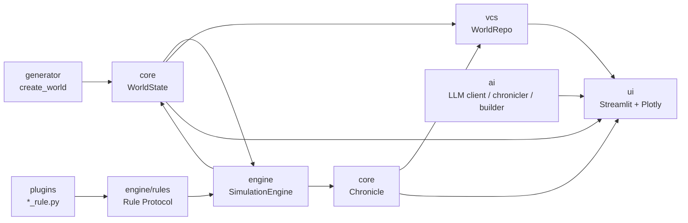
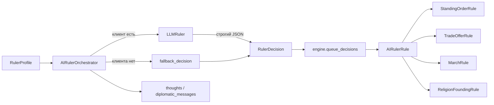

# Архитектура WorldSim

Документ описывает слои приложения, поток данных, инварианты и точки
расширения. Решения, стоящие за архитектурой, зафиксированы в
[ADR](adr/0001-src-layout.md).

## Обзор

WorldSim — прикладное веб-приложение: пользователь генерирует мир,
запускает годы симуляции, просматривает карту и летопись, сохраняет версии
и создаёт альтернативные реальности. Пакет не является публичной
библиотекой; точка входа — `worldsim` (`python -m worldsim`).



## Слои

| Слой | Каталог | Ответственность |
| --- | --- | --- |
| Домен | `src/worldsim/core/` | Неизменяемые модели: карта, фракции, события, летопись, культуры, войны, маршруты, снимок мира, RNG |
| Генерация | `src/worldsim/generator/` | Процедурная карта, фракции, территории |
| Движок | `src/worldsim/engine/` | Шаг времени, правила, метрики, загрузка плагинов |
| Версии | `src/worldsim/vcs/` | Коммиты, ветки, теги, diff, файловый репозиторий |
| ИИ | `src/worldsim/ai/` | Клиент LLM, хронист, генератор конфигурации, ИИ-правители, переписка и оркестратор года |
| Интерфейс | `src/worldsim/ui/` | Streamlit-страница, фигуры Plotly, мысли правителей, переписка, обёртки истории и ИИ |

## Поток данных

1. **Генерация.** `create_world(WorldConfig)` создаёт `WorldState`: карту
   `WorldMap`, фракции и назначенные территории. Все случайные числа берутся
   из `Rng(seed)`.
2. **Шаг симуляции.** `SimulationEngine.step()` сортирует правила по
   `(priority, name)`, передаёт каждому `StepContext` с метриками и
   генератором, применяет `RuleOutcome` через `WorldState.evolve` и добавляет
   события в `Chronicle`.
3. **Летопись.** `Chronicle` хранит события по годам в бинарном дереве
   поиска; `to_markdown()` и `to_json()` используются интерфейсом, ИИ и VCS.
4. **Версии.** `WorldRepo.commit()` сохраняет снимок и летопись в
   `.worldsim/objects/<id>.json`; `checkout()` восстанавливает состояние и
   историю; `diff()` сравнивает снимки.
5. **Интерфейс.** Streamlit читает готовые `WorldState`, `FactionStats`,
   `Commit` и `Diff`, не выполняя правил симуляции.
6. **ИИ-правитель (опционально).** `AIRulerOrchestrator.run_year()` собирает
   `RulerDecision` через `LLMRuler` или fallback, кладёт `AICommand` в
   `SimulationEngine`, выполняет шаг и записывает мысли/переписку в снимок.

## ИИ-правители



- `RulerProfile` задаёт стиль, интервал решений и имя; профили лежат в
  `WorldState.rulers`.
- `LLMRuler.decide` просит JSON с действием, целью, суммой, мыслью и
  уверенностью. Неизвестное действие, битый ответ или недоступный клиент
  переводят управление в `fallback_decision` без сети.
- `decision_interval` позволяет фракциям думать реже; в остальные годы
  действуют `StandingOrder`.
- `AIRulerRule` выполняет академию, набор, добычу, переселение и создание
  приказа/марша. Остальные правила этапа 6 обрабатывают приказы, сделки,
  марши и религии.
- Мысли (`RulerThought`) — короткие обоснования, а не полный
  chain-of-thought. Переписка (`DiplomaticMessage`) хранится отдельно и
  разрешается `resolve_message` детерминированно.
- UI показывает вкладки «🧠 Мысли» и «💬 Переписка»; без ИИ доступны
  fallback-мысли и шаблонные сообщения.

## Инварианты

- **Иммутабельность.** Все модели pydantic заморожены (`frozen=True`);
  изменение — только через `evolve()` с повторной валидацией. Летопись и
  снимки можно безопасно хранить и сравнивать.
- **Детерминизм.** Каждый источник случайности — `Rng`; глобальный
  `random` не используется. `Rng.fork(label)` выводит независимый поток из
  sha256, поэтому повторный запуск с тем же seed даёт тот же результат.
- **Стабильный хеш.** `WorldState.snapshot_hash()` — sha256 канонического
  JSON; одинаковые снимки дают одинаковый хеш и одинаковый id коммита.
- **Валидация ссылок.** Владельцы тайлов, столицы, войны, культуры,
  религии и торговые маршруты проверяются на уровне `WorldState`.
- **Вода нейтральна.** Водные тайлы не принадлежат фракциям и не имеют
  гарнизона.
- **ИИ-история.** Идентификаторы мыслей, приказов и сообщений уникальны,
  ссылки на фракции и тайлы валидируются; марши не начинаются и не
  заканчиваются на воде. Короткие мысли не являются скрытым
  chain-of-thought.

## Формат репозитория `.worldsim/`

```text
.worldsim/
├── HEAD                    # имя ветки или id коммита
├── objects/
│   └── <commit_id>.json    # коммит, снимок мира и летопись
└── refs/
    ├── branches/<name>     # указатель ветки на id
    └── tags/<name>         # именованная ссылка
```

`commit_id` — sha256 от родителя, года, сообщения и `snapshot_hash`.
Запись атомарная: временный файл рядом с целевым и `os.replace`.
Повреждённый объект или неизвестная ссылка даёт `RepositoryError`.
Слияние веток не поддерживается: альтернативные реальности независимы.

## Правила и приоритеты

| Приоритет | Правило | Файл |
| --- | --- | --- |
| 3 | `StandingOrderRule` | `engine/rules/orders.py` |
| 4 | `AIRulerRule` | `engine/rules/ai_ruler.py` |
| 5 | `EconomyRule` | `engine/rules/economy.py` |
| 6 | `ExtractionRule` | `engine/rules/extraction.py` |
| 6 | `ManaRule` | `engine/rules/magic.py` |
| 6 | `TradeOfferRule` | `engine/rules/trade_offers.py` |
| 7 | `ArmyMovementRule` | `engine/rules/army.py` |
| 8 | `FrontlineRule` | `engine/rules/army.py` |
| 9 | `FamineRule` | `engine/rules/random_events.py` |
| 9 | `MarchRule` | `engine/rules/march.py` |
| 10 | `ExpansionRule` | `engine/rules/expansion.py` |
| 10 | `PopulationGrowthRule` | `engine/rules/population.py` |
| 11 | `ManaRegenerationRule` (плагин) | `plugins/mana_rule.py` |
| 12 | `HappinessRule` | `engine/rules/social.py` |
| 13 | `UnrestRule` | `engine/rules/social.py` |
| 14 | `RiotRule` | `engine/rules/social.py` |
| 14 | `AcademyRule` | `engine/rules/magic.py` |
| 15 | `SecessionRule` | `engine/rules/social.py` |
| 15 | `MagicResearchRule` | `engine/rules/magic.py` |
| 16 | `UrbanizationRule` | `engine/rules/social.py` |
| 16 | `ReligionFoundingRule` | `engine/rules/religion.py` |
| 17 | `AssimilationRule` | `engine/rules/culture.py` |
| 18 | `CultureClashRule` | `engine/rules/culture.py` |
| 18 | `MagicCombatRule` | `engine/rules/battle_magic.py` |
| 19 | `ConversionRule` | `engine/rules/culture.py` |
| 20 | `PlagueRule` | `engine/rules/random_events.py` |
| 20 | `WarResolutionRule` | `engine/rules/war.py` |
| 21 | `OccupationRule` | `engine/rules/army.py` |
| 25 | `TradeRule` | `engine/rules/trade.py` |
| 30 | `DiplomacyRule` | `engine/rules/diplomacy.py` |

При равном приоритете порядок задаёт имя правила.

## Расширение

- **Новое правило.** Реализуйте `name`, `priority` и
  `apply(state, ctx) -> RuleOutcome`; верните изменения тайлов/фракций,
  события и, при необходимости, войны или маршруты. Передайте правило в
  `SimulationEngine`.
- **Плагин.** Положите `*_rule.py` в `plugins/` и экспортируйте `RULES`,
  `RULE` или класс правила. `load_rules(["plugins"])` проверит протокол,
  конфликты имён и изолирует падения.
- **Новая версия мира.** `WorldRepo.commit(state, message, chronicle=...)`,
  затем `checkout` или `create_branch` в интерфейсе «История».

## Ссылки

- [ADR 0001 — src-layout](adr/0001-src-layout.md)
- [ADR 0002 — frozen pydantic](adr/0002-frozen-pydantic.md)
- [ADR 0003 — BST-летопись](adr/0003-bst-chronicle.md)
- [ADR 0004 — JSON-репозиторий](adr/0004-json-vcs.md)
- [ADR 0005 — протокол правил](adr/0005-rules-protocol.md)
- [ADR 0006 — seeded RNG](adr/0006-seeded-rng.md)
- [ADR 0007 — ИИ-правители](adr/0007-ai-rulers.md)
